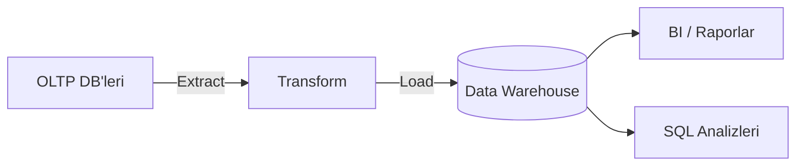

# Veri Sistemleri Mimarisinde Trade-Off'lar

  
    Bölüm 1
  

---
layout: default
---

# Bölümün Haritası

1. **Operational vs Analytical** sistemler
2. Data Warehousing → **Data Lake**
3. **Systems of Record** ve **Derived Data**
4. **Cloud vs Self-Hosting** ve cloud-native mimari
5. **Dağıtık vs Tek Düğümlü** sistemler
6. **Mikroservisler ve Serverless**
7. Cloud computing vs **Süperbilgisayarlar**

---
layout: section
---

# 1.1 Operational vs Analytical Sistemler

---
layout: default
---

# Veriyle Çalışan Üç Birim

### Backend Ekipleri
Verilerin **gösterimi ve güncellenmesi** ile ilgilenirler
→ *Operational System*

### İş Analistleri / BI Ekipleri
Verilerden **anlamlı raporlar** oluştururlar
→ *Analytical System*

### Veri Mühendisleri
Makine öğrenmesi gibi yöntemlerle **verimliliği artırmaya** çalışırlar
→ *Analytical System*

Operational sistemler okuma/yazma yapar; analytical sistemler ağırlıklı olarak <b>read-only</b> işlemler yapar.

---
layout: two-cols
---

# OLTP vs OLAP

**OLTP** — Online Transaction Processing

- CRUD işlemleri
- Son kullanıcı süreçleri
- Verinin **en güncel hali (latest state)**

::right::

**OLAP** — Online Analytical Processing

- Ad-hoc raporlar
- Toplu (bulk) işlemler, batch import
- **Toplulaştırma (aggregation)** raporları
- **Tarihsel veri**

---
layout: default
---

# Data Warehousing

- 1980'lerde OLAP ve OLTP süreçleri **aynı veritabanında** yönetiliyordu
- 1990'lardan sonra şirketler OLAP analizleri için ayrı **veri ambarları (data warehouse)** oluşturmaya başladı
  - Sorgu maliyetleri
  - SQL veritabanı yapılarının analiz için yeterli olmaması
- **ETL (Extract-Transform-Load)** yöntemi ile OLTP sistemlerinden alınan veriler dönüştürülerek ambarına yüklenir

---
layout: default
---

# Data Warehouse'dan Data Lake'e

- Veri ambarında iş analistleri **SQL sorguları** ile rapor alabilir
- Ancak **veri mühendisleri** için bu yeterli değildir:
  - ML için model eğitilebilecek nitelikte veri çıkarılması gerekir
- **Veri gölü (data lake):** farklı formatlardaki verileri, çoğunlukla nesne depolamada saklar
  - İşlem kayıtları, JSON olayları, loglar, görüntüler; ham veya işlenmiş veri
- **Veri göllerinde (data lake)** daha fazla **ham ve dağınık formatta** veri tutulur
  - Amaç: tüm veri mühendislerinin bunlardan anlamlı bir veri seti çıkarabilmesi

---
layout: default
---

# Systems of Record & Derived Data

### Record Data
- **Birincil veri kaynağı**
- Kullanıcıların orijinal verileri
- Doğruluğun referans noktası

### Derived Data
- Record'lardan **türetilir**
- Kaybolsa bile tekrar oluşturulabilir
- Önbellek, indeks, materialized view gibi ortamlarda tutulur

**Örnek:** Kullanıcı kayıtları (record) → arama indeksi ve önbellek (derived)

---
layout: section
---

# 1.2 Cloud vs Self-Hosting

---
layout: default
---

# Cloud vs Self-Hosting Spektrumu

- Sol taraf: **self-hosting** ve **self-operations**
- Sağa doğru gidildikçe hizmetlerin bir kısmı **dış hizmet** olarak alınır

**Temel fikir:** Bulut, kullandığın kadar öde modeliyle operasyon yükünü azaltır.

---
layout: two-cols
---

# Bulut Hizmetlerinin Artıları

- Zaman ve maliyet tasarrufu
- Kendi altyapını kurmaya kıyasla **hızlı hareket**
- Kurulum/bakım personeli işe almak ve eğitmek **maliyetli** olabilir
- Uzmanlaşmış sağlayıcıdan **daha iyi hizmet** alınabilir
- Yük dalgalandığında **kaynakları dinamik** ayarlama imkanı

::right::

# Eksileri / Dikkat Edilmesi Gerekenler

- Öngörülebilir yüklerde kendi makinen genelde **daha ucuz**
- Sağlayıcı senin iş yüküne özel **ince ayar (tuning)** yapamaz
- En yüksek yüke göre boyutlandırırsan kaynakların çoğu **boşta** kalır
- Bulutta da yine bir **operasyon ekibi** gerekir

---
layout: default
---

# Cloud-Native Sistem Mimarisi

- Sadece düşük seviyeli kaynakları (VM vb.) kullanmak değil, **daha üst seviye bulut servislerini** birleştirmek
- Örnek: **Nesne depolama** (S3, Azure Blob Storage, Cloudflare R2)
  - Standart dosya sistemlerinden **daha sınırlı API** (temel okuma/yazma)
  - Avantaj: altta yatan fiziksel cihazlar **gizlenir**
    - Veri birçok cihaza otomatik dağıtılır
    - Disk arızalarında bile veri kaybolmaz

---
layout: default
---

# Çoklu Kiracılık (Multitenancy)

- Bulut sistemleri genellikle **multitenant**'tır:
  - Her müşteri için ayrı makine yerine, birden fazla müşterinin verisi ve işlemi **aynı donanımda** işlenir
- **Avantajları:**
  - Donanımın daha verimli kullanımı
  - Kolay ölçeklendirme
  - Sağlayıcı için kolay yönetim
- **Dikkat edilmesi gereken:**
  - Bir müşterinin faaliyeti diğerlerinin **performansını veya güvenliğini** etkilememeli

---
layout: default
---

# Bulut Çağında Operasyonlar

**Self-hosting dünyasında** işletim süreçleri makine düzeyinde yoğundur:

- Kapasite planlaması (disk izleme, disk ekleme)
- Yeni makinelerin hazırlanması
- Hizmetlerin makineler arasında taşınması
- İşletim sistemi yamalarının yüklenmesi

**Bulut sistemlerde** bunların çoğunu **sağlayıcılar** üstlenir.

---
layout: section
---

# 1.3 Dağıtık vs Tek Düğümlü Sistemler

---
layout: default
---

# Dağıtık Sistem Nedir?

- Bir ağ üzerinden birbirleriyle iletişim kuran makinelerden oluşan sistem
- Sistemdeki her bir işlemciye **düğüm (node)** denir
- Veri bir serviste saklanıp başka bir serviste işleniyorsa **ağ üzerinden aktarım** gerekir
  - Bu nedenle **bulut-native sistemler ve mikroservisler dağıtıktır**

**Dağıtık mimariyi iten nedenler:**
Fault tolerance / yüksek erişilebilirlik • Ölçeklenebilirlik • Gecikme (latency) • Esneklik (elasticity) • Yasal uyumluluk (veri yerelleştirme kuralları)

---
layout: default
---

# Dağıtık Sistemlerin Sorunları

- **Ağ üzerinden her istek başarısız olabilir:**
  - Ağ kesilebilir, servis aşırı yüklenip çökebilir
  - İstek **timeout** olabilir → servisin isteği alıp almadığı **bilinemez**
  - İsteği tekrarlamak her zaman **güvenli değildir**
- **Sorun teşhisi zordur:**
  - Sistem yavaşsa darboğaz nerede?
  - Observability araçları: **OpenTelemetry, Zipkin, Jaeger**
- **Tutarlılık uygulamanın sorumluluğuna geçer:**
  - Her servisin kendi DB'si varsa, servisler arası tutarlılığı uygulama sağlar

Sonuç: Bir görevi tek makinede yapmak, dağıtık sistem kurmaktan genellikle <b>daha basit ve daha ucuzdur</b>.

---
layout: default
---

# Mikroservisler ve Serverless

**Mikroservis mimarisi:**

- Her servisin **belirli bir amacı** ve ayrı bir **sorumlu ekibi** var
- Servisler ağ üzerinden çağrılabilen **API** sunar
- Her servisin **kendi veritabanı** olması yaygındır
  - Paylaşılan DB yapısı servis API'sinin parçası olur, değiştirmek zorlaşır
  - Ayrıca sorgular diğer servislerin performansını etkileyebilir

**Zorluk:** Test (bağımlı servisler), deploy, izleme, log toplama, ölçekleme altyapısı → **Kubernetes** gibi orkestrasyon araçları

---
layout: default
---

# Serverless (FaaS)

- **Function as a Service** modelinde altyapı yönetimi **bulut sağlayıcısına** devredilir
- VM'lerde instansın ne zaman başlayıp duracağını **manuel** belirlersiniz
- Serverless'ta sağlayıcı kaynakları **otomatik** tahsis eder ve serbest bırakır
- **Ölçümlü faturalandırma:** kodun çalıştığı süre için ödeme yapılır
  - Bulut depolamanın kapasite planlaması yerine getirdiği modele benzer

---
layout: default
---

# Cloud Computing vs Süperbilgisayarlar

### Süperbilgisayarlar
- Hesaplama yoğun bilimsel işler
- Hava tahmini, iklim modelleme
- Moleküler dinamikler
- Karmaşık optimizasyon, diferansiyel denklemler

### Cloud Computing
- Çevrimiçi hizmetler
- İş veri sistemleri
- Kullanıcı taleplerini **yüksek erişilebilirlikle** karşılayan sistemler

---
layout: center
class: text-center
---

# Özet

- **Operational** (OLTP) ve **analytical** (OLAP) sistemler farklı ihtiyaçlara hizmet eder
- Analitik yolculuk: Warehouse → Lake → **streaming**
- **Record vs derived data** ayrımı mimaride kritik bir kavramdır
- Cloud, esneklik sağlar ama öngörülebilir yükte self-hosting daha ekonomik olabilir
- Dağıtık sistemler **ölçeklenebilirlik ve dayanıklılık** sağlar, ancak **karmaşıklık ve tutarlılık** bedeli vardır
