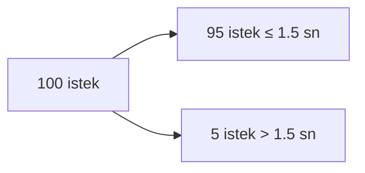

# Fonksiyonel Olmayan Gereksinimler

  
    Bölüm 2
  

---
layout: default
---

# Bölümün Haritası

1. **Performans:** response time ve throughput
2. **Gecikme (latency)** vs **yanıt süresi**
3. Ortalama, medyan ve **yüzdelikler** (p95, p99)
4. **Güvenilirlik ve hata toleransı**
5. **Ölçeklenebilirlik**
6. **Bakım kolaylığı (maintainability)**

---
layout: section
---

# Performansı Tanımlamak

---
layout: two-cols
---

# İki Ana Ölçüt

### Response Time
Bir isteğin **kullanıcıya dönüş süresi**

### Throughput
**Saniyede işlenen** istek sayısı

::right::

 

**Kuyruk etkisi:**

Yük düşükken yanıt süresi kısadır. Yük arttıkça yeni istek, öncekinin işlenmesini **bekler** ve yanıt süresi büyür.

Kapasite sınırına yaklaşıldıkça kuyruk gecikmeleri hızla artar.

---
layout: default
---

# Aşırı Yük Kısır Döngüsü

- Sistem çok yük altında ve kapasite tavan yaptıysa performans **daha da kötüleşebilir**
  - Geç yanıt alan istemciler **tekrar istek göndermeye** başlar → yük daha da artar
- Bu sorunları azaltmak için:
  - Client side:
    - **Exponential backoff** ile retry
    - **Circuit breaker**
  - Server side:
    - Rate limiting
    - **Backpressure** yanıtları (istemciye "yavaşla" deme)
    - Kuyruk yönetimi ve **load balancing** algoritmaları

Kullanıcılar için <b>response time</b> en görünür ölçüttür; ancak arka plandaki işlem kapasitesi de en az onun kadar önemlidir.

---
layout: default
---

# Latency vs Response Time

### Latency (Gecikme)
İsteğin **aktif olarak işlenmediği** süre

Ağ gecikmesi: istek ve yanıtın ağ üzerinden iletilme süresi

### Response Time
Kullanıcının gördüğü **toplam süre**

= servis süresi + kuyruk beklemesi + ağ gecikmesi

Bir sistem, yeni donanım eklendiğinde işlem kapasitesi artırılabiliyorsa <b>ölçeklenebilir</b>dir.

---
layout: default
---

# Ortalama, Medyan ve Yüzdelikler

- Ortalama (average) response time **yanıltıcıdır** — uç değerler (outlier) ortalamayı bozar
- **Medyan** alınarak uç değerler dışlanır ve daha iyi sonuçlar alınabilir.
- Yüzdelikler: **p95, p99, p99.9**
  - Örn. p95 = 1.5 sn ise: 100 istekten 95'i 1.5 sn altında, 5'i üzerinde tamamlanmıştır

---
layout: section
---

# Güvenilirlik ve Hata Toleransı

---
layout: default
---

# Güvenilir Yazılımdan Beklenenler

- Uygulama, kullanıcının beklediği **işlevleri yerine getirir**
- Hatalı davranışları **tolere edebilir**
- Beklenen yük ve veri altında **performans iyi** seviyededir
- **Yetkisiz erişim ve kötüye kullanımı** engeller

Tanım: Her şeyin doğru gitmediği durumlarda yazılımın <b>çalışmaya devam edebilmesi</b>.

---
layout: two-cols
---

# Fault vs Failure

### Fault
Bir **bileşenin** arızalanması

Örn: Disk bozuldu, bir düğüm çöktü

::right::

### Failure
Arıza sonucu **sistemin tamamen başarısız** hale gelmesi

Örn: Disk bozulduğunda veri kayboldu ve hizmet durdu

**Fault tolerance:** Sistemin **hataya dayanıklı** olması — fault'lar failure'a dönüşmeden sistemi ayakta tutmak

---
layout: default
---

# Donanım ve Yazılım Arızaları

### Donanım Arızaları
- Genellikle **yedekleme (redundancy)** çözümü uygulanır
- Disk RAID, çift güç kaynağı, yedek düğüm

### Yazılım Arızaları
- Çok çeşitlidir
- Arıza **tüm makinelerde aynı anda** oluşabilir → etkisi daha yüksek
- Örn: yeni sürümdeki bir bug, sıfıra bölme, yavaş bellek sızıntısı

---
layout: section
---

# Ölçeklenebilirlik

---
layout: default
---

# Ölçeklenebilirlik Nedir?

- Bir sistemin **artan yüklerle** başa çıkma yeteneği
- Ölçeklenebilirliği tanımlayan sorular:
  - Sistem büyümeye devam ederse bu büyümeye **nasıl cevap verir**?
  - Ek yükü karşılamak için **bilgi işlem kaynakları nasıl artırılır**?
  - Mevcut altyapı **sınırlarına ne zaman** ulaşılır?

**Önce yükü anla:**
- Sistemin mevcut yükü nedir?
- Yük artınca performans nasıl etkilenir?
- Performansı sabit tutmak için ne kadar kaynak eklenmeli?

---
layout: default
---

# Ölçekleme Mimarileri

### Paylaşımlı Bellek
Tek sunucu üzerinde çalışır

**Dikey ölçekleme:** daha güçlü makineye geç

### Paylaşımlı Disk
Farklı sunucular, **ortak disk**

Sunucular bağımsız, veri ortak

### Paylaşımsız (Shared-Nothing)
Birden fazla düğüm **kendi kaynaklarıyla**

Yazılımsal haberleşme

<b>Yatay ölçekleme (paylaşımsız)</b> avantajı: kaynaklar duruma göre ayarlanır + hata toleransı artar.
Dezavantajı: <b>dağıtık sistem karmaşıklığı</b>.

---
layout: default
---

# Ölçeklenebilirliğin Anahtarı: Ayrıştırma

- En önemli ilke: sistemi **birbirinden ayrıştırmak (decoupling)**
- **Mikroservisler** bu işe yarar
- Paylaşımsız (shared-nothing) mimari temele alınmış olur

**Trade-off:** Ayrıştırma ölçeklenebilirlik ve dayanıklılık sağlar; karşılığında operasyonel karmaşıklık ve dağıtık tutarlılık sorunları getirir.

---
layout: section
---

# Bakım Kolaylığı (Maintainability)

---
layout: default
---

# Yazılım Eskimez, Ama...

- Yazılımlar **eskimez** — ancak talepler ve teknolojiler değişir, **güncellenir**
- Bakım kolaylığı için:
  - **Değiştirilebilirlik (evolvability):** yazılım değişime kolay uyum sağlamalı
  - **Sade ve kolay kullanılabilir** olmalı
- **Karmaşıklığı yönetmek:**
  - İyi bir **soyutlama** yapılmalı
  - Gereksiz bağımlılıklardan kaçınılmalı

---
layout: center
class: text-center
---

# Özet

- Performansı **response time** ve **throughput** ile ölç; ortalamaya değil **yüzdeliklere** bak
- Aşırı yükte **kuyruk kısır döngüsüne** karşı backoff, breaker, backpressure kullan
- **Fault ≠ failure:** fault tolerance, fault'ların failure'a dönüşmesini engeller
- Ölçeklenebilirlik: önce **yükü anla**, sonra dikey/yatay strateji seç
- Ayrıştırma (decoupling) ölçeklenebilirliğin anahtarıdır
- **Değiştirilebilirlik** uzun vadeli bakım kolaylığının temelidir
