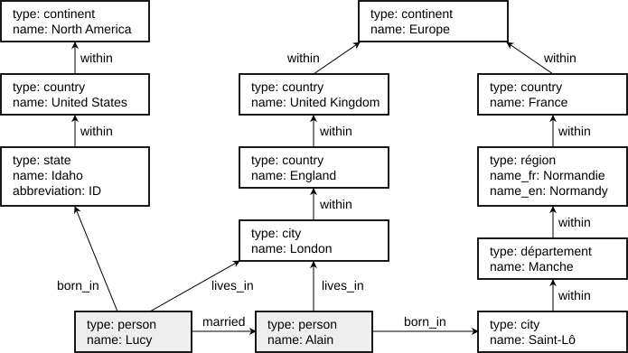
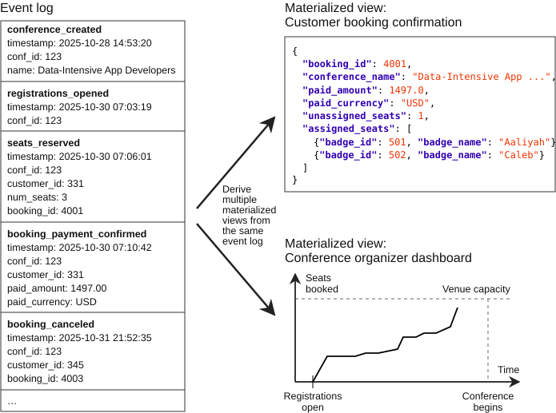
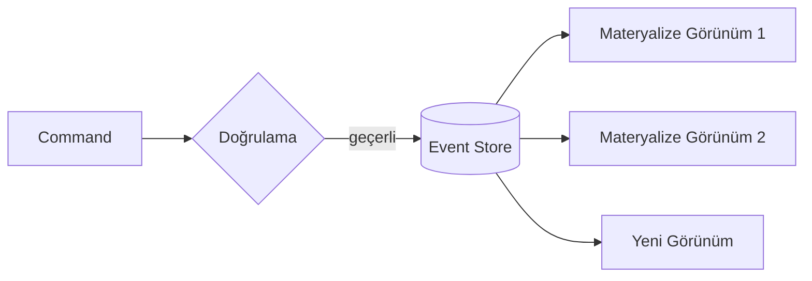

# Veri Modelleri ve Sorgu Dilleri

<div class="pt-12">
  <span class="px-2 py-1 rounded text-sm" style="background: var(--slidev-code-background)">
    Bölüm 3
  </span>
</div>

---
layout: default
---

# Bölümün Haritası

1. **İlişkisel vs Belge (document)** modeller
2. **Grafik (graph)** veri modelleri
3. **Event Sourcing ve CQRS**
4. **DataFrame, matris ve diziler**

---
layout: default
---

# Katmanlı Soyutlama

- Yazılımdaki her katman, **altındaki katmanın verisini soyutlayarak** üstüne daha üst seviye bir arayüz sunar
- Veri modeli seçimi, üstteki katmanların **ne yapabileceğini** belirler:
  - Uygulama kodunun nasıl yazılacağını
  - Sorguların nasıl ifade edileceğini

<div class="mt-6 p-4 rounded" style="background: var(--slidev-code-background)">

Uygulama geliştiricisi → JSON/nesne modeliyle çalışır • Veritabanı → tablo/belge/grafik modeliyle saklar • Donanım → baytlar ve disk blokları

</div>

---
layout: section
---

# 3.1 İlişkisel vs Belge Modelleri

---
layout: default
---

# İlişkisel Model

- En çok bilinen **SQL modeli** — 1970'de **Edgar Codd** tarafından önerildi
- Veriler tablolarda, **satır ve sütunlar** halinde tutulur
- Veri ekleme için **şema** gerekir; sorgular SQL ile ifade edilir
- Güçlü **join** desteği ve tutarlılık garantileri

# NoSQL Dalgası

- 2010'lu yıllarda çıkan NoSQL veritabanları yeni özellikler getirdi:
  - **Esnek şemalar**
  - **Ölçeklenebilirlik** hedefi
  - **Açık kaynak** lisans modeli

---
layout: default
---

# Normalizasyon ve Join'ler

- İlişkisel modelde veri **normalize** edilir; tekrar azaltılır
- Okurken farklı tablolar **join** ile birleştirilir
- **Document-based** veritabanlarının bir kısmı join desteklemez
  - **MongoDB**'de `$lookup` operatörü ile yapılabilir
  - Destek yoksa: referans tutulamaz → **veri tekrarlı** şekilde saklanır (denormalizasyon)

```js
// MongoDB: $lookup ile join
db.orders.aggregate([
  { $lookup: {
      from: "users",
      localField: "userId",
      foreignField: "_id",
      as: "user"
  }}
])
```

---
layout: two-cols
---

# Ne Zaman Hangisi?

**Belge modeli:**
Veri **belge benzeri** yapıdaysa:
- Bir-çok ilişkiler ve
- Yapı genellikle **tek seferde** yükleniyorsa

Belge yapısını tablolara bölmek gereksiz karmaşık kodlara yol açar.

::right::

**İlişkisel model:**
- Varlıklar arasında **çok sayıda many-to-many** ilişki varsa
- Sık sık **parça parça** sorgulama gerekiyorsa
- Güçlü tutarlılık ve join desteği gerekiyorsa

---
layout: default
---

# Belge Modelinin Tuzakları

- **Yerel avantaj (locality)** yalnızca belgenin büyük kısmına aynı anda ihtiyaç duyulduğunda geçerlidir
- Veritabanı genellikle **belgenin tamamını** yükler
  - Büyük belgenin küçük bir kısmı gerekiyorsa **israf**
- Belgede değişiklikte **tamamı yeniden yazılır**
- Öneri:
  - Belgeleri **küçük tut**
  - Sık sık küçük değişikliklerden kaçın

---
layout: section
---

# 3.2 Grafik Veri Modelleri

---
layout: default
---

# Grafik Model Nedir?

- Uygulamada **many-to-many ilişki fazlaysa** grafik model uygun olur
- Köşeler **(node/vertex)** varlıkları, kenarlar **(edge)** ilişkileri temsil eder
- Sosyal ağlarda çok kullanılır:
  - İnsanlar, yerler, olaylar, yorumlar → **hepsi birer node**
  - Aralarındaki ilişkiler → **edge** (arkadaşlık, beğenme, katılma...)
- Node'lar tek bir türü temsil etmek **zorunda değildir**
- Grafik yapıları yeni özelliklerde bile **değişime kolay uyum sağlar**

**Örnek sistemler:** Neo4j • Amazon Neptune • Memgraph

---
layout: default
---

# Grafik Model Türleri

<div class="grid grid-cols-[0.85fr_1.65fr] gap-5 mt-4 items-center">

<div class="p-3 rounded text-sm" style="background: var(--slidev-code-background)">

### Property-Graph Model
**Node'da:**
- Unique ID, nesne türü/label
- İçe ve dışa kenarlar
- Key-value property'ler

**Edge'de:**
- Unique ID, başlangıç ve bitiş düğümü
- İlişki türü
- Key-value çiftleri

### Triple-Store Model
Veriler **özne - yüklem - nesne** üçlüleri olarak tutulur

Örn:
`(Ali, arkadaş, Ayşe)`
`(Ali, doğumYeri, İstanbul)`

</div>

<div class="text-center">



<p class="text-xs opacity-75 mt-3">Property-graph örneği: kişiler ve yerler düğüm, aralarındaki ilişkiler kenardır.</p>

</div>

</div>

---
layout: section
---

# 3.3 Event Sourcing ve CQRS

---
layout: default
---

# Temel Fikir

<div class="grid grid-cols-[0.9fr_1.4fr] gap-5 items-center">

<div class="text-sm">

- Verinin her zaman **en güncel hâlini** tutmak gerekmeyebilir
- Verileri yazmanın en basit ve hızlı yolu: **olay günlüğü (event log)** tutmak
- **Olay tabanlı veri modellemesi:**
  - Olayları **gerçekliğin kaynağı** olarak kullan
  - Her durum değişikliğini bir **olay** olarak ifade et
- **CQRS (Command-Query Responsibility Segregation):**
  - Okuma için optimize edilmiş yapıları ayrı tut
  - Bunları yazma için optimize edilmiş yapılardan **türet**

</div>



</div>

---
layout: two-cols
---

# Command vs Event

### Command (Komut)
Kullanıcıdan gelen istek

- **Öncelikle doğrulanmalı**
- Geçerliyse (örn. yeterli boş koltuk varsa) gerçekleştirilir

::right::

### Event (Olay)
Gerçekleşmiş **geçerli** değişikliğin kaydı

- Olay kaydı yalnızca **geçerli olayları** içerir
- Olayı tüketen sistemler bir olayı **reddedemez**

---
layout: default
---

# Materyalize Görünümler

- Temel prensip: materyalize görünümler, olay günlüğünden **tekrarlanabilir şekilde** elde edilir
- Görünümleri her zaman **silebilir** ve:
  - Aynı olayları
  - Aynı sırayla
  - Aynı kodla yeniden işleyerek **yeniden hesaplayabilirsiniz**
- Yeni bilgi sunmak isterseniz, mevcut olaylardan **yeni bir yapı** oluşturmak kolaydır



---
layout: two-cols
---

# Avantajlar

- Yeni özellikler için **yeni olay türleri** eklenebilir
  - Eski olaylar **değiştirilmez**
- Hatalı olaylar **silme olayı** ile düzeltilir → veri otomatik tutarlı hale gelir
- Doğrudan update/delete yapan DB'lerde geri alma zordur; olay tabanlı yaklaşım **geri alınamaz işlemleri azaltır**
- Değişimi kolaylaştırır (evolvability)

::right::

# Zorluklar

- Sonradan yapılan hesaplamalarla değişen verilerin **sabit hallerini tutmamak** → tekrar hesaplamada **farklı tutarlara** yol açabilir (mesela ürün fiyatı 1 yıl önce farklı olduğunda, aynı logları bu yıl aynı sırayla işlemek aynı sonucu vermeyecektir)
- **Sıralama garantisi kritik:**
  - Event store, tüm materyalize görünümlerin olayları **log'daki sırayla** işlemesini garanti etmeli
  - Dağıtık sistemde bu **her zaman kolay sağlanamaz** (bkz. Bölüm 10)

<div class="mt-4 text-sm">

**Araçlar:** EventStoreDB • Axon Framework

</div>

---
layout: section
---

# 3.4 DataFrame, Matris ve Diziler

---
layout: default
---

# DataFrames, Matrices, Arrays

- **DataFrame'ler**, veri bilimciler için popüler bir araç:
  - Makine öğrenimi modellerini eğitmek için veri hazırlama
  - Veri keşfi ve istatistiksel analiz
  - Veri görselleştirme
- Pandas (Python), R data.frame, Spark DataFrame gibi araçlar bu modeli kullanır

---
layout: center
class: text-center
---

# Özet

- **Belge modeli** bir-çok ve tek seferde yüklenen veriler için; **ilişkisel model** many-to-many ve join ağırlıklı işler için uygundur
- **Grafik modeller** (property-graph, triple-store) yoğun ilişkilerde güçlüdür
- **GraphQL** istemci esnekliği sağlar; yetkilendirme ve performans bedeli vardır
- **Event Sourcing + CQRS:** olayları gerçeğin kaynağı yap, okuma modellerini türet
- Model seçimi, uygulamanın **evrimleşebilirliğini** doğrudan etkiler
