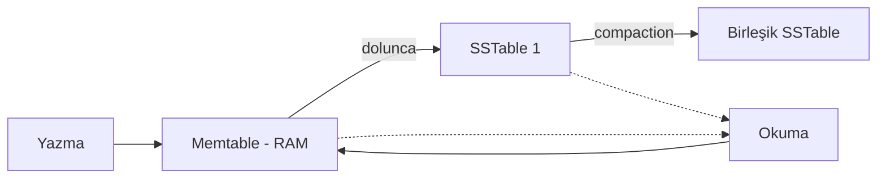

# Depolama ve Veri Getirme

  
    Bölüm 4
  

---
layout: default
---

# Bölümün Haritası

1. **OLTP için depolama ve indeksleme**
2. **Log-structured** depolama: Hash index, SSTable, LSM-Tree
3. **B-Tree** indeksler
4. **B-Tree vs LSM-Tree** karşılaştırması
5. İkincil ve **çok sütunlu indeksler**
6. **Bellek içi (in-memory)** veritabanları
7. **Analitik için depolama**: sorgu yürütme, görünümler, tam metin indeksler

---
layout: default
---

# Neden Depolama Detaylarını Bilmeli?

- Bir veritabanının verileri **nasıl sakladığını** bilmek, ihtiyaca göre **DB seçimini** kolaylaştırır
- İş yükü profili (okuma ağırlıklı / yazma ağırlıklı) motor seçimini belirler
- Trade-off'ları anlamak, üretimde karşılaşılan performans sorunlarını teşhis etmeyi sağlar

---
layout: section
---

# 4.1 OLTP İçin Depolama ve İndeksleme

---
layout: default
---

# İndeksler: Okuma Hızı vs Yazma Maliyeti

- OLTP veritabanlarında **veri yazmak kolaydır**; okuma için **indeksler** kullanılır
- İndeksler yazma işleminde de **maliyeti artırır**
  - Her indeks ek **disk alanı** tüketir
  - Her yazma, indekslerin de güncellenmesini gerektirir
- Bu nedenle veritabanları **her şeyi otomatik indekslemez**
  - Uygulamanın tipik sorgu desenlerini bilen geliştirici **manuel** seçer
  - Böylece en faydalı indeksler seçilir, yazmaya gereksiz yük bindirilmez

---
layout: default
---

# Log-Structured Depolama: Hash Index

- En kolay yaklaşım: **Hash tablosunda** her kaydın **diskteki offset'ini** tutmak
  - `key → byte offset` eşlemesi
- **Sorun:**
  - Offset tablosu **önbellekte** tutulmalı
  - Her yeniden başlatmada (restart) yeniden kurulmalı
- Hash index ile aralık sorguları verimli değildir — sadece tam anahtar eşleşmesi hızlıdır

Temel fikir: <b>append-only log</b> + bellekte indeks. Yazma hızlıdır çünkü sadece sona eklenir.

---
layout: default
---

# SSTable ve LSM-Tree

**SSTable (Sorted String Table):** Anahtarlara göre **sıralı** segment dosyaları

**LSM-Tree (Log-Structured Merge-Tree) çalışma şekli:**

1. Yazma önce bellekteki **memtable**'a gider (sıralı yapı)
2. Memtable dolunca **SSTable** olarak diske yazılır
3. Arka planda segmentler **birleştirilir (compaction)**
4. Okuma: önce memtable → sonra yeni → eski SSTable'lar

---
layout: section
---

# B-Tree İndeksler

---
layout: default
---

# B-Tree Nedir?

- 1970'te tanıtıldı; kısa sürede "her yerde kullanılan" yapı oldu
- Neredeyse tüm **ilişkisel veritabanlarında standart indeks** yapısı
- Birçok ilişkisel olmayan veritabanında da kullanılır
- Anahtar ararken **kök sayfadan** başlanır:
  - Sayfalarda anahtarlar ve alt sayfa **referansları** bulunur
  - Her alt sayfa belirli bir **anahtar aralığından** sorumludur
  - Referanslar arasındaki anahtarlar aralık **sınırlarını** gösterir

---
layout: default
---

# B-Tree Özellikleri

- Algoritma ağacın **dengeli kalmasını** sağlar:
  - n anahtarlı B-tree'nin derinliği her zaman **O(log n)**
- Çoğu veritabanı **3-4 seviyeli** bir B-tree'ye sığar
  - Çok fazla sayfa referansına ihtiyaç duyulmaz
  - Örnek: dallanma faktörü 500, 4 KiB sayfalar → 4 seviye ≈ **250 TB** veri
- **Tutarlılık riski:** Tutarsız update veya disk bozulması sorun olabilir
  - Çözüm: **WAL (Write-Ahead Log)**
  - Update önce WAL'e yazılır; çökme sonrası buradan kurtarma yapılır

---
layout: default
---

# B-Tree Bakımı: Vacuum

- B-tree'ler zamanla **parçalanabilir (fragmentation)**
  - Çok sayıda anahtar silinirse, kullanılmayan sayfalar kalır
- Sonradan eklenen veriler bu boş sayfaları kullanabilir
  - Ancak dosyanın ortasındaki sayfalar **işletim sistemine geri verilemez**
- Bu nedenle arka planda çalışan **bakım süreçleri** gerekir
  - PostgreSQL'de: **vacuum process**

---
layout: default
---

# B-Tree vs LSM-Tree

| | **LSM-Tree** | **B-Tree** |
| --- | --- | --- |
| **Yazma** | Yoğun yazma için daha uygun | Yazma daha maliyetli |
| **Okuma** | Okuma için daha yavaş | Okuma için daha hızlı |
| **Yapı** | Append-only + compaction | Sayfa bazlı, yerinde güncelleme |
| **Örnek** | Cassandra, ScyllaDB, RocksDB | PostgreSQL, MySQL (InnoDB) |

- Kesin bir "ya da" yoktur; bazı motorlar **iki yaklaşımı birleştirir** (birden fazla B-tree'yi LSM tarzı birleştirmek gibi)
- Geçerli karşılaştırma için sistemleri **kendi iş yükünüzle** test edin

---
layout: default
---

# İkincil ve Çok Sütunlu İndeksler

**İkincil indeks (secondary index):**
- Birincil anahtardan farklı sütunlara göre arama
- İlişkisel DB'de `CREATE INDEX` ile aynı tabloda birden çok indeks oluşturulabilir

**Çok sütunlu (birleştirilmiş) indeks:**
- Çeşitli alanlar **birleştirilerek tek anahtar** oluşturulur
- Telefon rehberi benzetmesi: *(soyad, ad, telefon)*
  - Belirli bir **soyada** göre arama: verimli
  - Belirli bir **ada** göre arama: bu indeks işe yaramaz (soldan sağa sıralama kuralı)

---
layout: default
---

# Her Şeyi Bellekte Tutmak

- RAM maliyeti düştükçe **bellek içi (in-memory) veritabanları** geliştirildi
- Birçok veri seti o kadar büyük değil; bellekte tutulabilir
- İki farklı amaç:
  - **Önbellek:** Memcached gibi; yeniden başlatmada veri kaybı kabul edilebilir
  - **Dayanıklılık:** Bellekteki veri kaybolmasın diye:
    - Pil destekli RAM gibi özel donanımlar
    - Diske **log/change kaydı** tutmak
    - Periyodik **snapshot** alma
    - Veriyi diğer makinelere **kopyalama**

---
layout: section
---

# 4.2 Analitik İçin Depolama

---
layout: default
---

# Analitik Depolama

- Cloud veri ambarlarında farklı veri **saklama formatları** kullanılır
- Analitik sorgular çok büyük tablolar üzerinde **toplulaştırma** yapar
- Satır bazlı depolama yerine **sütun bazlı (columnar)** depolama:
  - Sadece gereken sütunlar okunur → I/O tasarrufu
  - Benzer değerler yan yana → **yüksek sıkıştırma**
- Örn: Parquet, ORC, veri ambarı tablo formatları

---
layout: default
---

# Sorgu Yürütme: Compile vs Vectorization

- Karmaşık SQL sorguları birden fazla aşamalı **sorgu planına** dönüştürülür
  - Aşamalara **işlemci (operator)** denir; paralel çalışabilir
  - Planlayıcı: hangi işlemciler, hangi sırayla, nerede çalışacak?

### Compile
- SQL'den **kod üretilir**
- Satırlar tek tek incelenir
- Makine koduna derlenir (**LLVM**), JIT'e benzer

### Vectorization
- Sorgu **derlenmez**
- Sütundaki değerler **toplu işlenir** → hız artar
- Önceden tanımlı **operatörler** argüman alıp sonuç döndürür

---
layout: default
---

# Materialized ve Virtual View'lar, Data Cubes

### Virtual View
Her çağrıda **tekrar çalıştırılır**

Güncel ama maliyetli

### Materialized View
Arka planda **güncel tutulur**

Hızlı ama bayat olabilir

### Data Cube
Materyalize görünüm üzerindeki **matematiksel özetler**

Çok boyutlu toplamlar

---
layout: default
---

# Çok Boyutlu ve Tam Metin İndeksler

- **Çok boyutlu indeksler:** Birden fazla boyutta aralık sorguları (örn. konum + zaman)
  - R-tree, KD-tree gibi yapılar
- **Tam metin (full-text) indeksler:**
  - **Lucene** (Elasticsearch ve Solr'un motoru):
    - Terimlerin içerik listelerine eşleşmesini **SSTable benzeri sıralı dosyalarda** saklar
    - Bu dosyalar arka planda **birleştirilir** (LSM mantığı)
  - **PostgreSQL GIN indeksi:** JSON belgelerinde tam metin arama ve indeksleme
  - İnverted index mantığı: `kelime → geçtiği belgeler`

---
layout: center
class: text-center
---

# Özet

- **İndeks** = okuma hızı ↔ yazma maliyeti trade-off'u
- **LSM-Tree:** yazma yoğun iş yüklerine uygun (memtable + SSTable + compaction)
- **B-Tree:** okuma hızlı; WAL ile tutarlılık; vacuum ile bakım
- **İkincil/çok sütunlu indeksler** sorgu desenlerine göre seçilir
- **Bellek içi DB'ler** önbellek veya dayanıklılık için farklılaşır
- Analitik tarafta **sütun bazlı depolama**, vektörize/delik derlenmiş sorgu yürütme
- **Materyalize görünümler** ve tam metin indeksler (Lucene, GIN) yaygın araçlardır
