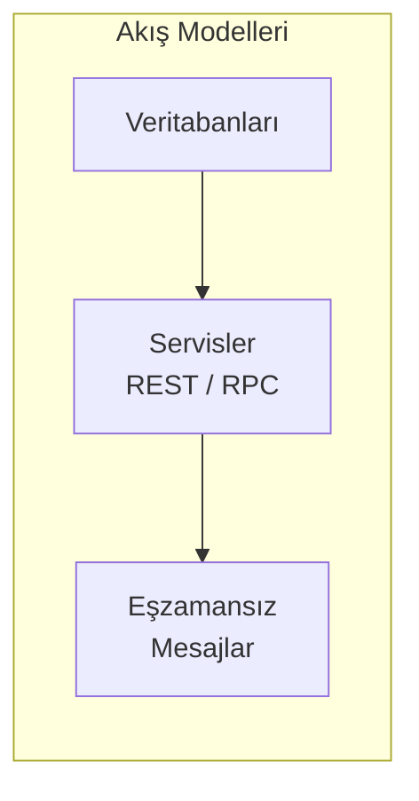

# Veri Kodlama ve Evrim

<div class="pt-12">
  <span class="px-2 py-1 rounded text-sm" style="background: var(--slidev-code-background)">
    Bölüm 5
  </span>
</div>

---
layout: default
---

# Bölümün Haritası

1. **Uyumluluk (compatibility)** türleri
2. **Kodlama formatları:**
   - Dile özgü formatlar
   - JSON / XML / CSV
   - JSON Schema
   - **Protocol Buffers**
3. **Veri akış modelleri:**
   - Veritabanları üzerinden
   - Servisler üzerinden (REST / RPC)
   - **Event-driven** mimariler

---
layout: default
---

# Değişebilirlik

- Sistemleri, değişikliklere **kolay uyum sağlayacak** şekilde tasarlamalıyız
- Veri formatları ve şemalar zamanla **değişir**; sistemler eski ve yeni verilerle aynı anda çalışabilmeli

<div class="mt-8 p-4 rounded" style="background: var(--slidev-code-background)">

**Temel soru:** Yeni kod eski veriyi okuyabilir mi? Eski kod yeni veriyi okuyabilir mi?

</div>

---
layout: default
---

# İki Tür Uyumluluk

<div class="grid grid-cols-2 gap-6 mt-6">

<div class="p-4 rounded" style="background: var(--slidev-code-background)">

### Backward Compatibility
**Geriye dönük uyumluluk**

Yeni kod, **eski** kodun yazdığı veriyi okuyabilir

*Yeni kod eski veriyi anlar*

</div>

<div class="p-4 rounded" style="background: var(--slidev-code-background)">

### Forward Compatibility
**İleriye dönük uyumluluk**

Eski kod, **yeni** kodun yazdığı veriyi okuyabilir

*Eski kod yeni veriyi tolere eder*

</div>

</div>

<div class="mt-8 opacity-80">

Genellikle **backward compatibility sağlamak daha kolaydır** — eski veriyi bilerek okuyabilirsin. Forward için yeni alanları tolere etmek gerekir.

</div>

---
layout: default
---

# Neden Kodlama (Encoding) Gerekli?

- Programlar bellekteki nesnelerle (struct, object) çalışır
- Ağ üzerinden veya diskte veri **bayt dizileri** olarak taşınır
- Çoğu sistemin, bu iki dünya arasında **dönüşüm** yapması gerekir
  - Nesne → baytlar: **encoding / serialization / marshalling**
  - Baytlar → nesne: **decoding / deserialization / parsing**
- Yaygın bir sorun olduğundan **sayısız kütüphane ve format** var

---
layout: section
---

# Kodlama Formatları

---
layout: default
---

# Dile Özgü Formatlar

- Çoğu programlama dili nesneleri baytlara çevirmeyi destekler:
  - Java: `java.io.Serializable` (ayrıca **Kryo** gibi kütüphaneler)
  - Python: `pickle`
  - Ruby: `Marshal`
- **Sorunlar:**
  - Dile **bağımlı**
  - Güvenlik riskleri
  - Sürüm uyumluluğu zayıf

<div class="mt-4 opacity-80">
Bu nedenle native formatlar yerine genellikle <b>JSON/XML gibi dilden bağımsız</b> formatlar kullanılır.
</div>

---
layout: default
---

# JSON, XML ve CSV

- Kusurlara rağmen birçok amaç için **yeterince iyi** formatlar
- Özellikle **veri alışverişi** amacıyla popülerliklerini koruyacaklar
- Önemli olan: taraflar format konusunda **anlaşırsa**, formatın verimliliği ikinci plandadır
  - Farklı kuruluşların **anlaşmasını sağlamak**, diğer sorunlardan daha zordur

---
layout: default
---

# JSON Schema

- **Açık içerik modeli:**
  - Şemada tanımlanmamış alanlar **her türle** bulunabilir
  - `additionalProperties: true` (varsayılan)
- **Kapalı içerik modeli:**
  - Yalnızca **açıkça tanımlanmış alanlar** kabul edilir
- Genellikle JSON Schema'lar **hangi değerlerin kabul edilemeyeceğini** belirtir
  - Yani tanımlı alanlarda geçersiz değerler nelerdir

```json
{
  "type": "object",
  "properties": {
    "userName": { "type": "string" },
    "favoriteNumber": { "type": "integer" }
  },
  "required": ["userName"]
}
```

---
layout: default
---

# Protocol Buffers

- **İkili (binary)** kodlama formatı — her veri için bir **şema** gerekir
- Şema, Protocol Buffers'ın **IDL (arayüz tanımlama dili)** ile tanımlanır

<div class="grid grid-cols-2 gap-6 mt-4">

<div>

### Şema (`person.proto`)

```proto
syntax = "proto3";

message Person {
  string user_name = 1;
  int64 favorite_number = 2;
  repeated string interests = 3;
}
```

</div>

<div>

### Örnek Mesaj (Text Format)

```text
user_name: "Ayşe"
favorite_number: 42
interests: "veritabanları"
interests: "dağıtık sistemler"
```

<p class="text-sm opacity-80">Okunabilir gösterimdir; ağda mesaj, alan adları yerine <b>tag numaraları ve değerlerle</b> ikili olarak kodlanır.</p>

</div>

</div>

- Alan **adları değiştirilebilir**
- Ancak `1, 2, 3` gibi **tag numaraları değiştirilemez**
  - Alan adları veriyle birlikte tutulmadığı için ad değişikliği sorun olmaz

---
layout: section
---

# Veri Akış Modelleri

---
layout: default
---

# Veri Akışına Genel Bakış

Veriler, süreçler arasında farklı yollarla aktarılır:



**Sorular:**
- Format hangi uyumluluk garantilerini sağlıyor?
- Veri akarken **eski ve yeni kod** aynı anda çalışabilir mi?

---
layout: default
---

# Veritabanları Üzerinden Veri Akışı

- Uygulamanın yeni sürümü dağıtılınca eski sürüm birkaç dakikada **tamamen değişir**
- Ancak veritabanındaki veriler **öyle değildir:**
  - Beş yıl önceki veriler, manuel değiştirilmediyse hâlâ **orijinal biçiminde**
- Bu durum şöyle özetlenir:

<div class="mt-8 p-6 rounded text-center text-xl" style="background: var(--slidev-code-background)">

**"Veriler, koddan daha uzun ömürlüdür."**

</div>

<div class="mt-6">
Bu yüzden şema değişikliklerinde <b>eski istemcilerin</b> hâlâ çalıştığı varsayılmalıdır (rolling upgrade).
</div>

---
layout: default
---

# Servisler: REST ve RPC

- Servisi çağıran kod şunları bilmeli:
  - Hangi **HTTP uç noktasına** başvurulacak
  - Ne tür **veri formatları** gönderilecek / alınacak
- Servis geliştiricileri API'yi tanımlamak için **IDL** kullanır:
  - **OpenAPI (Swagger):** JSON ile konuşan web servisleri
  - **Protocol Buffers:** gRPC servisleri
- Yüksek erişilebilirlik için servisin **birden fazla örneği** çalışır
  - İsteklerin dağıtılmasına **yük dengeleme (load balancing)** denir
  - Birçok yük dengeleme ve **servis keşfi** çözümü mevcuttur

---
layout: default
---

# Event-Driven Mimariler

- Gönderici ile alıcıyı **mantıksal olarak ayırır**
  - Gönderici mesajı yayınlar; **kimin okuduğuyla ilgilenmez**
- İki temel dağıtım modeli:

<div class="grid grid-cols-2 gap-6 mt-4">

<div class="p-4 rounded" style="background: var(--slidev-code-background)">

### Kuyruk (Queue)
- Mesaj belirli bir kuyruğa gider
- Birden fazla alıcı olsa bile mesajı **sadece biri** alır

*Point-to-point*

</div>

<div class="p-4 rounded" style="background: var(--slidev-code-background)">

### Konu (Topic)
- Mesaj bir konuya gönderilir
- Aracı mesajı **tüm abonelere** iletir

*Pub/sub*

</div>

</div>

---
layout: default
---

# Mesaj Aracılarında Kalıcılık

- Mesaj aracıları **kalıcılık** açısından farklılaşır:
  - Birçoğu mesajları **diske yazar** → çökme/restart durumunda mesajlar korunur
  - Veritabanlarının aksine, çoğu mesaj **okunduktan sonra siler**
  - Bazıları mesajları **süresiz saklamak** üzere ayarlanabilir
- Olay tabanlı veri yönetimi (event sourcing) kullanmak istiyorsanız bu özellik **gereklidir**

<div class="mt-6 p-4 rounded" style="background: var(--slidev-code-background)">

**Örnekler:** Kafka (log tabanlı, saklamaya uygun) • RabbitMQ (klasik kuyruk) • Amazon SQS/SNS

</div>

---
layout: center
class: text-center
---

# Özet

- **Backward compatibility** (yeni kod → eski veri) genelde daha kolay; **forward compatibility** (eski kod → yeni veri) tolerans gerektirir
- Dile özgü formatlardan kaçın; **JSON/XML** yaygın ve yeterli, **Protobuf** verimli ve şema tabanlı
- **Veri koddan uzun ömürlüdür** → şema evrimi tasarımın ilk gününden düşünülmeli
- Veri akışı: **veritabanları, servisler (REST/RPC), event-driven** kanallar
- Event-driven mimaride **queue vs topic** ve **mesaj kalıcılığı** kritik tasarım kararlarıdır
