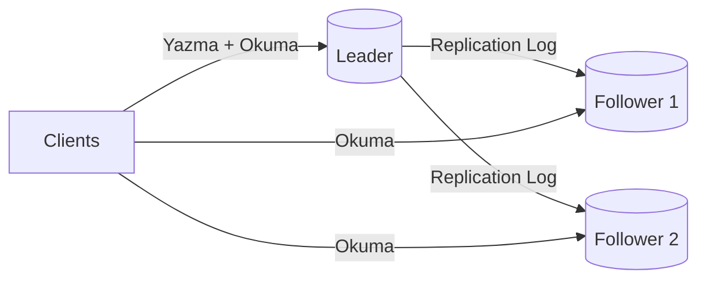
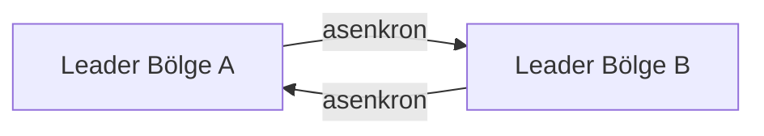
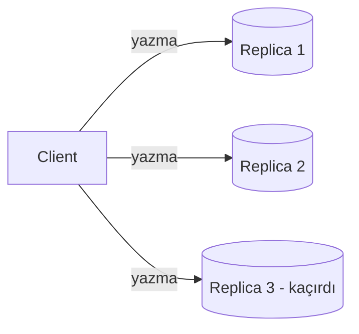
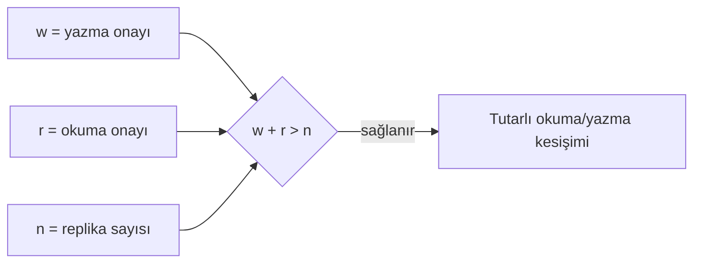

# Replikasyon

  
    Bölüm 6
  

---
layout: default
---

# Bölümün Haritası

1. **Neden replikasyon?** Replikasyon vs yedekleme
2. **Single-leader** replikasyon
3. **Senkron vs asenkron** ve failover
4. Replication log implementasyonları
5. **Replication lag** problemleri ve çözümleri
6. **Multi-leader** replikasyon ve çatışma yönetimi
7. **Leaderless** replikasyon

---
layout: default
---

# Replikasyon Nedir?

- Aynı verinin, bir ağ üzerinden bağlı **birden fazla makinede** bulundurulması
- **Nedenleri:**
  - Veriyi kullanıcılara **coğrafi olarak yakın** tutmak (düşük gecikme)
  - Sistemin bazı parçaları bozulsa bile **ayakta kalması** (availability)
  - Okuma kaynağını artırarak **daha fazla işlem kapasitesi**

---
layout: default
---

# Replikasyon vs Yedekleme (Backup)

- Replikasyon yapıyorsan **yine de yedek alman gerekir** — ikisi farklı işlevler:

### Replikasyon
- Değişiklikler diğer düğümlere **hızlı iletilir**
- Güncel kopyalar sağlar

### Yedekleme
- Verinin **eski hallerini** saklar
- Geçmişe dönmeyi sağlar

**Örnek:** Yanlışlıkla veri sildiysen replikasyon işe yaramaz — silme işlemi tüm replikalara aktarılmıştır. Geri yükleme için <b>yedek</b> gerekir.

---
layout: section
---

# 6.1 Single-Leader Replikasyon

---
layout: default
---

# Lider Tabanlı Replikasyon

- Veritabanının bir kopyasını saklayan her düğüme **replica** denir
- Her yazma işlemi **tüm kopyalar** tarafından işlenmelidir
- En yaygın çözüm: **single-leader** (birincil-yedek / aktif-pasif) replikasyon

1. Yazmalar **lider** üzerinden gider
2. Lider değişiklikleri **followers**'lara iletir
3. Okuma hem liderden hem follower'dan yapılabilir

---
layout: default
---

# Nerede Kullanılır?

- Yaygın olarak kullanılan bir yaklaşım:
  - **PostgreSQL, MySQL, Oracle Data Guard, SQL Server** (Always On availability groups)
  - **MongoDB, DynamoDB** gibi belge tabanlı veritabanları
  - **Kafka** gibi mesajlaşma araçları
  - **DRBD** gibi blok cihazlar ve bazı ağ dosya sistemleri
- Eski kaynaklarda bu sisteme **Master-Slave** de denir

---
layout: default
---

# Senkron vs Asenkron Replikasyon

### Senkron
- Follower, liderle **aynı veriye** sahip
- Lider çökerse follower'daki veri **güvende**
- **Dezavantaj:** Follower yanıt vermezse (çökme/ağ) yazma **durabilir**

### Asenkron
- Lider, follower'ı **beklemez**
- Yazma her zaman devam eder
- **Dezavantaj:** Lider çökerse, henüz kopyalanmamış son yazmalar **kaybolabilir**

**Yarı-senkron:** Bir follower senkron, diğerleri asenkron. Senkron olan yavaşlarsa/çökerse, asenkron biri <b>senkron hale getirilir</b>. Böylece veri en az iki düğümde güncel olur.

---
layout: default
---

# Yeni Follower Ekleme (Setting Up New Followers)

Sisteme yeni bir follower eklerken:

1. Liderden tutarlı bir **backup/snapshot** alınır
2. Snapshot **follower'a kurulur**
3. PostgreSQL'de **log sequence number** kullanılarak snapshot'tan sonraki değişiklikler eşitlenir
4. Follower, yeni güncellemeleri **dinlemeye devam eder**

Kilit nokta: snapshot alınırken gelen yazmaların kaybolmaması için <b>tutarlılık noktası</b> takip edilir.

---
layout: default
---

# Düğüm Arızalarının Giderilmesi

- Amacımız: bireysel düğüm arızalarına rağmen **sistemin çalışmaya devam etmesi**
- Bakım sırasında (örn. güvenlik yaması için restart) düğümler kesintisiz yeniden başlatılabilmeli

**Follower failure — kolay:**
- Follower, işlediği son işlemin kaydını **yerel diskinde** tutar
- Yeniden başlayınca liderle bağlantı kurar ve **kaçırdığı değişiklikleri** ister
- Senkronize olduktan sonra normal akışa döner

---
layout: default
---

# Leader Failure (Failover)

Liderin başarısız olmasını yönetmek daha zordur:

1. **Failover (devralma)** süreci başlar
2. Followers'dan biri **yeni lider** olarak atanır
3. İstemciler yazmalarını yeni lidere gönderecek şekilde **yeniden ayarlanır**
4. Diğer follower'lar yeni liderden **değişiklikleri almaya başlar**

**Zorluklar:**
- Kısmen uygulanmış yazmalar (asenkron) kaybolabilir
- Split-brain riski: iki düğüm kendini lider sanabilir
- Doğru **timeout** seçimi: çok kısa → gereksiz failover, çok uzun → uzun kesinti

---
layout: default
---

# Replication Log Implementasyonları

Follower'lara **hangi formatta** değişiklik gönderilir?

### Statement-Based
Her **DML işlemi** (örn. `UPDATE`) takipçilere iletilir

- Sorun: `NOW()`, `RANDOM()` gibi **side effect**'li ifadeler
- İdempotent olmayan işlemler tutarsızlık yaratır

### WAL-Based
**Bayt seviyesinde** fiziksel log aktarılır

- Verimli ama depolama motoruna sıkı bağlı
- Sürüm farkı sorun olabilir

### Logical (Row-Based)
Satır değişiklikleri **mantıksal** olarak aktarılır

- Storage engine'den bağımsız
- CDC (change data capture) için temel

---
layout: section
---

# 6.2 Replication Lag Problemleri

---
layout: default
---

# Replication Lag Nedir?

- Lider tabanlı replikasyonda tüm yazmalar **liderden** geçer
- Okuma yükü follower'lara dağıtılır → ölçeklenebilirlik
- Ancak follower **geride kalırsa (lag)** asenkron okuyan uygulamalar **eski veri** görür
  - Aynı sorgu lider ve follower'da **farklı sonuç** verebilir
  - Tutarsızlık **geçicidir** — yazma durup beklersen düzelir

---
layout: default
---

# Tutarlılık Garantileri

**Read-after-write (okuma-sonrası-yazma):**
- Kullanıcı yazdığı veriyi **hemen** görmelidir
- Çözüm: kullanıcının yazdığı kayıtlar **liderden** okunur

**Monotonic reads (monotonik okuma):**
- Aynı kullanıcı **zamanda geriye gitmez**
  - İlk okumada yeni veri, sonrakinde eski veri görmemeli
- Çözüm: kullanıcı kimliği hash'ine göre **her zaman aynı replikadan** okuma

---
layout: default
---

# Tutarlılık: Basit Programlama Modeli

- Uygulama geliştiricileri için en basit model: **kopyaların tutarlılığını garanti eden** veritabanı seçmek
  - Doğrusallık (linearizability) + **ACID işlemler** → veritabanı sanki **tek düğüm** gibi kullanılır
- 2010'ların başında NoSQL yaklaşımı bunun **ölçeklenebilirliği sınırladığını** savundu
  - Büyük ölçekli sistemlerin **"nihai tutarlılık"** (eventual consistency) kabul etmesi gerektiği görüşü

---
layout: section
---

# 6.3 Multi-Leader Replikasyon

---
layout: default
---

# Neden Multi-Leader?

- Single-leader'ın büyük dezavantajı: **tek lider** üzerinden yazma
  - Liderle bağlantı kurulamazsa (ağ kesintisi) **yazılamaz**
- Multi-leader (aktif-aktif): **birden fazla düğüm yazmayı kabul eder**

**Kullanım senaryoları:**

1. **Coğrafi dağıtık sistemler:**
   - Her bölgede bir lider + read yapan takipçiler
   - Bölgeler arası gecikme azalır; bağlantı kesilse de bölge çalışır
2. **Çevrimdışı çalışma** (mobil, masaüstü uygulamalar)

---
layout: default
---

# İşlem Sırası Zayıflığı

- Tek liderli sistemler **güçlü tutarlılık** garantileri sunar (bkz. Bölüm 8, serileştirilebilir işlemler)
- Çoklu liderli sistemlerin en büyük dezavantajı: **tutarlılık çok daha zayıf**
  - Banka hesabının eksiye düşmemesi garanti edilemez
  - Kullanıcı adının benzersizliği garanti edilemez
- Farklı liderlerdeki işlemler tek başına sorunsuzken, **birleştiğinde kural ihlali** oluşabilir

---
layout: default
---

# Sync Engines ve Local-First Yazılım

- Multi-leader, uygulamanın **internet olmadan da çalışması** gerektiğinde uygundur:
  - Takvim, not uygulamaları — çevrimdışı değişiklikler cihazlar arasında senkronlanır
- Modern işbirlikçi uygulamalar: **Google Docs/Sheets, Figma, Linear**
  - Değişiklikler sunucu yanıtı beklenmeden **anında UI'da** gösterilir
  - Her tarayıcı sekmesi dosyanın bir **kopyasıdır** → multi-leader yapı
- Bu süreci destekleyen kütüphaneye **"eşitleme motoru" (sync engine)** denir
  - **Çevrimdışı öncelikli (offline-first)** uygulamalar
  - **Yerel öncelikli (local-first):** geliştirici tüm hizmetleri kapatsa bile çalışır

---
layout: default
---

# Çatışan Yazmaların Yönetimi

- Multi-leader'ın en büyük sorunu: **eşzamanlı yazmaların çakışması**

**Çatışmayı önleme:**
- Aynı kaydın tüm yazmaları **tek liderden** geçsin
  - Geo-dağıtık sunucu sistemlerinde bazen mümkün
  - Çevrimdışı senkron motorlarında **mümkün değil**
- Lider sorumluluğu değişirse (bölge taşıma/erişilemezlik) çatışma oluşabilir

**Çatışmayı çözme:**
- **Last Write Wins (LWW):** En yeni zaman damgası kazanır
  - Basit ama **veri kaybına** yol açabilir
- **Manuel çözüm:** Kullanıcıya sor (azsa uygulanabilir)
- **Otomatik çözümler:** **OT** (Operational Transformation), **CRDT** (Conflict-free Replicated Data Type)

---
layout: section
---

# 6.4 Leaderless Replikasyon

---
layout: default
---

# Lideri Olmayan Yaklaşım

- Bazı sistemler "lider" kavramından tamamen **vazgeçer**
- Herhangi bir kopya, istemciden gelen yazmayı **doğrudan kabul eder**
- Tarihçe- > İlk replikalı sistemlerin bazıları lidersizdi
  - **2007'de Amazon Dynamo** ile yeniden popülerleşti- **Riak, Cassandra, ScyllaDB** — Dynamo'dan esinlenen açık kaynak sistemler

---
layout: default
---

# Quorum Mekanizması

- Bazı uygulamalarda istemci yazmayı **doğrudan kopyalara** gönderir; bazılarında **koordinatör düğüm** üstlenir
- Liderli sistemin aksine, koordinatör yazmaların **belirli sırada** işlenmesini zorunlu kılmaz
**Quorum kuralı:**

- Okuma **birden fazla node'a** gider; karşılıklı kontrollerle **tutarlılık** sağlanır
- Pratikte: 7 düğümden 4'ü veya 9 düğümden 5'i gibi quorum'lar

---
layout: default
---

# Anti-Entropy ve Read Repair

- Arka planda çalışan süreç, kopyalar arası **farklılıkları periyodik kontrol eder**
  - Eksik veriyi bir kopyadan diğerine **kopyalar**
- **Anti-entropy:** bu arka plan senkronizasyon süreci
  - Lider tabanlıdan farklı olarak **belirli sıra yok**, gecikmeler olabilir
- **Read repair:** Okuma sırasında eski olduğu anlaşılan kopyaya **anlık güncelleme** yapılır

Örnek: 3. nod güncellemeyi alamadı. Okuma birden fazla noda gittiğinde fark tespit edilir ve düzeltilir.

---
layout: default
---

# Single-Leader vs Leaderless: Performans

| | **Single-Leader** | **Leaderless** |
| --- | --- | --- |
| **Tutarlılık** | Güçlü garanti mümkün | Zayıf (quorum'a bağlı) |
| **Okuma** | Lider kapasitesiyle sınırlı | Paralel gönderim; en hızlı yanıt kullanılır |
| **Yavaş düğüm etkisi** | Lider yavaşsa herkes etkilenir | Az etki — istek dengeleme |
| **Failover** | Gerekir | Gerekmez |

**Leaderless zorlukları:**
- Bir kopya, diğerinin kullanılamaz olduğunu **fark etmeli** ve kaçırdığı yazmaları sonradan almalı
- Kopya sayısı arttıkça **quorum beklemesi** uzar
  - Yavaş yanıt veren kopyayla karşılaşma olasılığı artar

---
layout: center
class: text-center
---

# Özet

- Replikasyon: gecikmeyi azaltır, erişilebilirliği ve okuma kapasitesini artırır — **yedekleme değildir**
- **Single-leader:** güçlü tutarlılık; failover ve replication lag sorunları
- **Senkron vs asenkron:** dayanıklılık ↔ kullanılabilirlik trade-off'u
- **Multi-leader:** coğrafi dağıtım ve offline-first; çatışma çözümü gerekir (LWW, OT, CRDT)
- **Leaderless:** Dynamo tarzı, quorum (w+r>n), anti-entropy ve read repair
- Tutarlılık garantileri: read-after-write, monotonic reads
