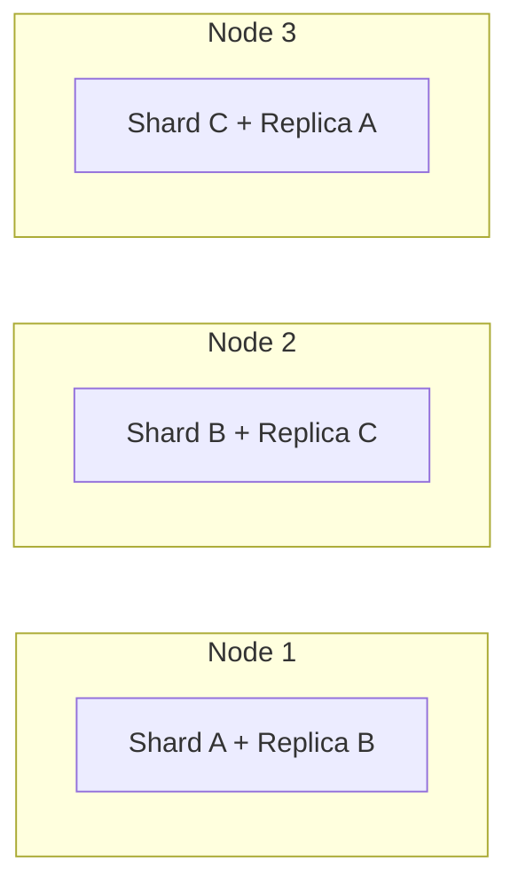
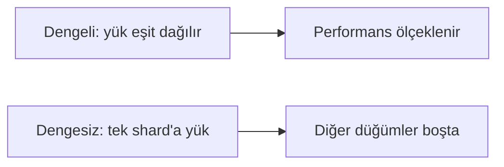

# Sharding (Parçalama)

  
    Bölüm 7
  

---
layout: default
---

# Bölümün Haritası

1. Replikasyon + **sharding** birlikte
2. Terminoloji: **partitioning vs sharding**
3. **Ne zaman** sharding yapılır?
4. **Key-value** verilerin parçalanması
5. **Dengesizlik, hot shard, hot key**
6. Yeni düğüm ekleme ve **rebalancing**

---
layout: default
---

# Veri Düğümler Arasında Nasıl Dağıtılır?

Dağıtık veritabanları veriyi iki şekilde dağıtır:

1. **Replikasyon:** Aynı verinin kopyalarını **birden fazla düğümde** saklamak (Bölüm 6)
2. **Sharding:** Veri miktarı veya yazma hızı tek düğümün üstesinden gelemeyecek seviyedeyse:
   - Veriyi **daha küçük parçalara** bölmek
   - Parçaları **farklı düğümlerde** saklamak

---
layout: default
---

# Replikasyon + Sharding Birlikte

- Sharding genellikle **replikasyon ile birlikte** kullanılır:
  - Her shard'ın kopyaları **birden fazla nodda** saklanır
  - Her kayıt tam olarak **tek bir shard'da** bulunur
  - Ama hata toleransı için farklı nodlarda **kopyaları** tutulur
- Single-leader yapıda: her shard'ın kendi lider-follower grubu olabilir

Kazanç: hem ölçeklenebilirlik (sharding) hem dayanıklılık (replication) aynı anda.

---
layout: default
---

# Terminoloji: Partitioning vs Sharding

- Bazı veritabanlarında iki kavram **ayrıdır**:
  - **PostgreSQL'de bölümlendirme (partitioning):**
    - Büyük bir tablonun **aynı makinede** çeşitli dosyalara bölünmesi
    - Avantaj: tüm bir bölüm **hızlıca silinebilir**
  - **Sharding:** veri setinin **birden fazla makineye** dağıtılması
- Diğer birçok sistemde "bölümlendirme", aslında **sharding'in diğer adıdır**

---
layout: section
---

# Ne Zaman Sharding?

---
layout: default
---

# Avantajlar

- **Temel neden: ölçeklenebilirlik**
  - Veri miktarı veya yazma hacmi tek düğümü aşarsa → birden fazla düğüme dağıt
- Yatay ölçekleme sağlayan **temel araç**
  - Daha büyük makineye geçmek yerine **daha fazla (küçük) makine** ekle
- İş yükü eşit bölünürse parçalar **paralel** işlenir

**Kritik uyarı:** Sorun **okuma** işlemleriyle ilgiliyse sharding gerekmez — replika ekleyerek okuma ölçeklenir (Bölüm 6).

---
layout: default
---

# Ne Zaman Sharding Yapılmamalı?

- Veri hacminiz ve yazma hızınız **tek bir makinenin** üstesinden gelebileceği seviyedeyse
  - Günümüzde tek bir makine bile oldukça büyük yükleri kaldırabilir
- Bu durumda **tek parçalı** veritabanı kullanmak daha iyidir
  - Sharding karmaşıklığını (dağıtık sorgu, rebalancing, ikincil indeksler...) gereksiz yere almış olursunuz

**Veri modeline göre zorluk:**

| Veri Tipi | Sharding Zorluğu |
| --- | --- |
| **Key-value** | Kolay — anahtara göre böl |
| **İlişkisel** | Zor — ikincil indeksler ve join'ler |

---
layout: section
---

# Key-Value Verilerin Sharding'i

---
layout: default
---

# Amaç: Eşit Yük Dağılımı

- Sharding'in amacı: veriyi ve sorgu yükünü düğümler arasında **eşit dağıtmak**
  - 10 düğüm, tek düğümün işleyebileceğinin **10 katı** veri ve okuma/yazma hızı
  - (Replikasyon göz ardı edildiğinde)
- Düğüm eklendiğinde/çıkarıldığında yük **yeniden dengelenmeli (rebalancing)**

---
layout: default
---

# Dengesizlik, Hot Shard ve Hot Key

- Bölümleme adil değilse (bazı shard'lar daha fazla veri/sorgu alıyorsa) → **dengesizlik (skew)**
  - Etkinlik büyük ölçüde azalır
  - Aşırı durumda tüm yük tek shard'a biner; 10 düğümden 9'u boş kalır
- Aşırı yüklenen shard'lara **sıcak shard / sıcak nokta (hot spot)** denir
- Tek bir anahtarın yükü özellikle yüksekse → **sıcak anahtar (hot key)**
  - Örnek: Sosyal ağdaki **ünlü bir kişinin** profili
  - Çözüm: anahtarı bölmek (örn. rastgele suffix ekleme) — uygulama karmaşıklığı getirir

---
layout: default
---

# Bölümleme Anahtarını Seçmek

Veri setini parçalara ayırmak için bir **algoritma** gerekir:
- Girdi: kaydın **bölümleme anahtarı (partition key)**
- Çıktı: kaydın hangi **parçada** olduğu

**Anahtar seçimi:**
- **Key-value** depolarında: genellikle anahtarın kendisi (veya ilk kısmı)
- **İlişkisel** modellerde: bir sütun olabilir (birincil anahtar olmak zorunda değil)

**Gereksinim:**
- Algoritma, aşırı yüklenen bölgeleri azaltmak için **yeniden dengeleme** işlemlerine uyum sağlayabilmeli

---
layout: default
---

# Yeniden Dengeleme Stratejileri

- **Hash ile parçalama:** `hash(key) % N`
  - Düğüm sayısı (N) değişince neredeyse tüm anahtarların yeri değişir → kötü
- Daha iyi yaklaşımlar:
  - **Sabit sayıda shard** (düğümden çok) → shard'lar düğümler arasında taşınır
  - **Tutarlı hashing (consistent hashing):** az sayıda anahtarın yeri değişir
  - **Dinamik bölünme:** shard büyüdükçe ikiye bölünür
- Yeniden dengeleme sırasında sistem **okuma/yazmaya devam edebilmeli**

---
layout: center
class: text-center
---

# Özet

- **Sharding = yatay ölçekleme:** veriyi parçalara böl, farklı düğümlere dağıt
- Genellikle **replikasyon ile birleşir:** her shard'ın kopyaları farklı nodlarda
- **Önce gerekli mi?** sorusunu sor — okuma sorunuysa replika, tek makine yetiyorsa sharding yapma
- **Dengesizlik → hot shard / hot key** performansı çökertir
- **Partition key** seçimi ve **rebalancing stratejisi** (consistent hashing, dinamik bölünme) tasarımın kalbindedir
- Multitenancy'de shard'lar izolasyon ve izin yönetimi sağlar
